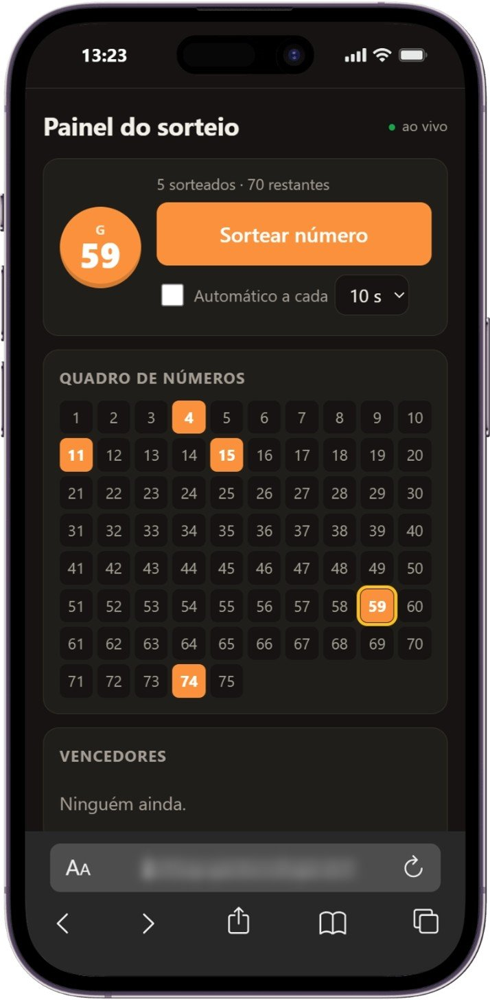
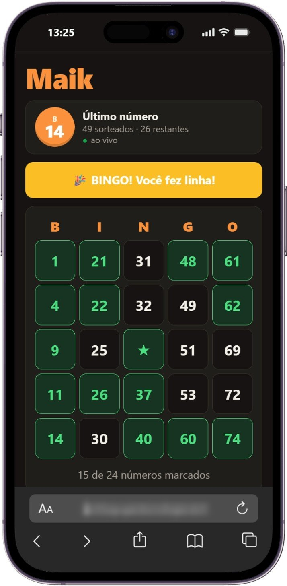
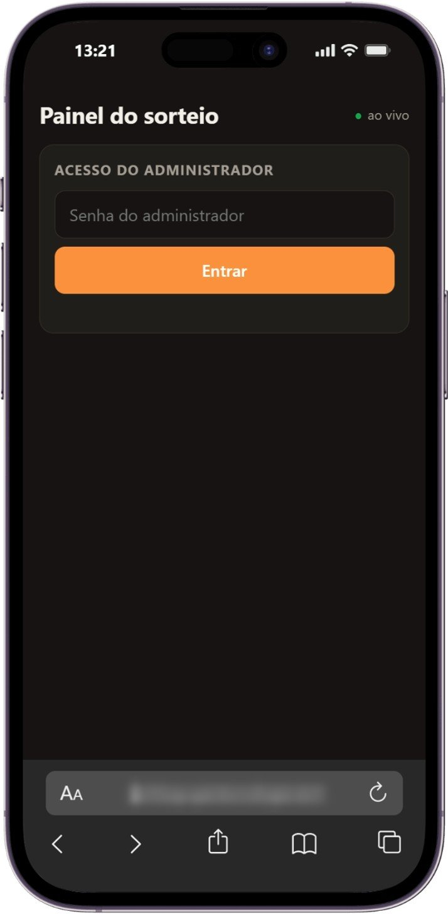
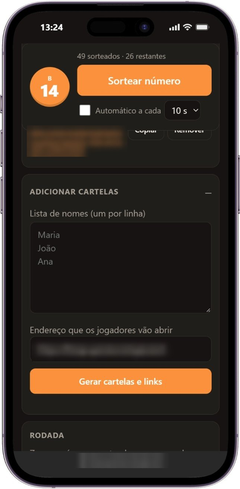
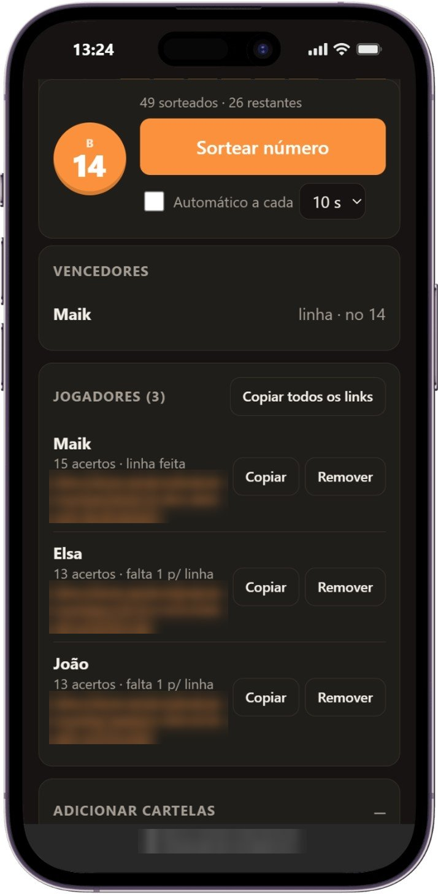
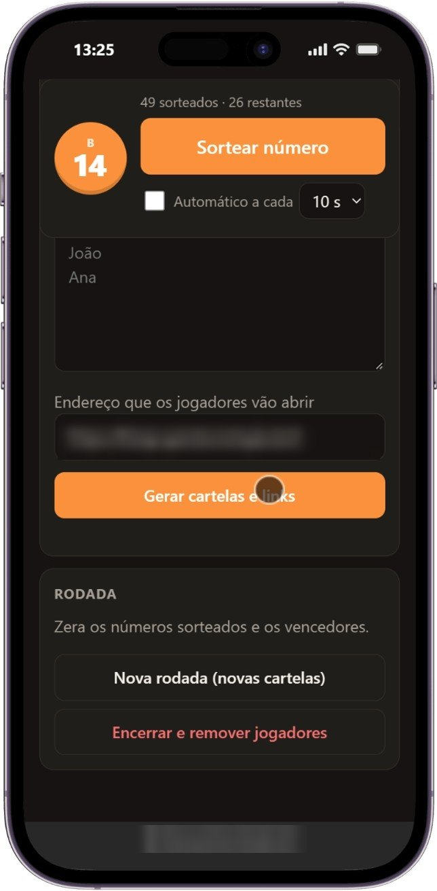

# 🎱 Bingo ao vivo

Bingo online para jogar pelo celular. O **organizador** sorteia os números num painel, e cada **jogador** abre a própria cartela por um link. Quando sai um número, ele é marcado sozinho, na hora, em todas as cartelas que o têm.

Ninguém precisa instalar nada nem criar conta: basta abrir um link no navegador.

<p align="center">
  
  &nbsp;&nbsp;
  
</p>

---

## Como funciona, em 4 passos

1. **O organizador entra no painel** (`/admin`) com a senha.
2. **Cola a lista de nomes** e gera uma cartela e um link para cada pessoa.
3. **Manda os links** para os jogadores, por exemplo no WhatsApp.
4. **Sorteia os números.** As cartelas são marcadas sozinhas, e o sistema avisa quem fez **linha** ou **cartela cheia**.

---

## 👑 Para o organizador

### 1. Entrar no painel

Abra `https://seu-endereco/admin` e digite a senha do administrador.



### 2. Criar as cartelas

Em **Adicionar cartelas**, escreva **um nome por linha** e toque em **Gerar cartelas e links**.

O campo **"Endereço que os jogadores vão abrir"** já vem preenchido com o endereço do site. Só mude se for usar outro endereço.



### 3. Enviar os links

Em **Jogadores**, cada pessoa tem um link próprio:

| Botão | O que faz |
|---|---|
| **Copiar** | Copia o link de uma pessoa |
| **Copiar todos os links** | Copia a lista inteira (`Nome: link`), pronta para colar no grupo |
| **Remover** | Apaga a cartela daquela pessoa, com confirmação |

A lista mostra quantos números cada pessoa acertou e **quanto falta para fazer linha**. Quem está mais perto de ganhar aparece primeiro.



### 4. Sortear

- Toque em **Sortear número**. O número aparece na bola laranja e é marcado no quadro de 1 a 75. O último sorteado fica com contorno amarelo.
- Para não precisar tocar a cada número, marque **Automático a cada** e escolha o intervalo (5, 10, 20 ou 30 segundos).
- No celular, o botão **Sortear** fica fixo no topo da tela, mesmo rolando a página.

### 5. Vencedores

O sistema confere as cartelas a cada número sorteado:

| Prêmio | Quando acontece |
|---|---|
| **Linha** | Uma linha completa: horizontal, vertical ou diagonal |
| **Cartela cheia** | Todos os números da cartela marcados |

Os vencedores aparecem em **Vencedores** e num aviso amarelo no topo. O sorteio automático para sozinho quando alguém completa a cartela.

### 6. Nova rodada ou fim de jogo



| Botão | O que faz |
|---|---|
| **Nova rodada (novas cartelas)** | Zera os números e os vencedores. Cada pessoa recebe uma cartela nova **no mesmo link**, sem precisar reenviar. |
| **Encerrar e remover jogadores** | Zera tudo e apaga todas as cartelas. Os links antigos deixam de funcionar. |

Os dois botões pedem confirmação antes de agir.

---

## 🙋 Para o jogador

Abra o link que recebeu. Só isso.

- Seu **nome aparece grande no topo** da página.
- A barra logo abaixo mostra o **último número sorteado**.
- Os números da sua cartela que já saíram ficam **verdes**. A estrela ★ no centro é a casa livre, que já começa marcada.
- O celular **vibra** quando sai um número seu.
- Quando você faz linha ou completa a cartela, aparece o aviso **🎉 BINGO!**.
- A tela não apaga durante o jogo, e a página se reconecta sozinha se a internet cair.


> A cartela segue o padrão **B-I-N-G-O**: a coluna B tem números de 1 a 15, I de 16 a 30, N de 31 a 45, G de 46 a 60 e O de 61 a 75.

---

## 🛠️ Instalação

Precisa só do **Node.js 18 ou mais novo**. Não há dependências para instalar.

### Rodar no computador

```bash
npm start
```

- Jogadores: `http://localhost:3000`
- Organizador: `http://localhost:3000/admin`

Para quem está na mesma rede Wi-Fi, troque `localhost` pelo IP do computador, por exemplo `http://192.168.0.10:3000`.

### Configuração

| Variável | Para que serve | Padrão |
|---|---|---|
| `ADMIN_PASSWORD` | Senha do painel do organizador | Gerada a cada início e mostrada no terminal |
| `PORT` | Porta do servidor | `3000` |

### Publicar no Easypanel (ou outro servidor com Docker)

O projeto já tem um `Dockerfile`.

1. Crie um serviço **App** com origem **GitHub**, branch `main` e caminho `/`.
2. Em **Build**, escolha **Dockerfile**.
3. Em **Environment**, defina `ADMIN_PASSWORD=sua-senha`.
4. Em **Domains**, use a porta **3000**.
5. Clique em **Deploy**.

---

## ⚠️ Bom saber

- **O jogo fica só na memória.** Reiniciar ou publicar uma nova versão apaga jogadores, cartelas e sorteios. Não faça deploy durante uma partida.
- **Use uma única instância** (1 réplica). Com mais de uma, cada cópia teria um jogo diferente.
- **Cada link é a cartela de uma pessoa.** Quem tiver o link vê aquela cartela, então envie cada um só para o dono.

---

## Estrutura

```
src/server.js      servidor (sorteio, cartelas, vencedores e envio ao vivo)
public/index.html  página da cartela do jogador
public/admin.html  painel do organizador
public/live.js     conexão ao vivo e reconexão automática
public/style.css   visual (pensado primeiro para celular)
docs/images/       imagens deste README
```
